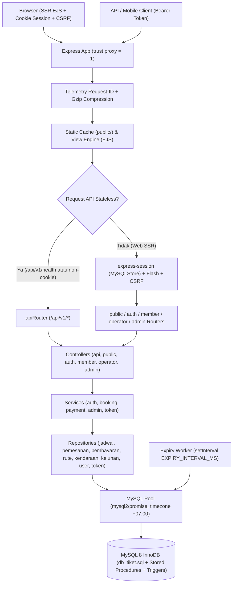

# TRANSKOTA Travel

Sistem reservasi tiket minibus antarkota eksekutif berbasis web monolith (**Express SSR EJS** + **REST API `/api/v1/*`**) di atas **MySQL 8 InnoDB** dengan jaminan reservasi kursi atomik bebas *double-booking*, manajemen jadwal real-time, verifikasi pembayaran manual, e-ticket QR code, dan dashboard multi-peran.

Repository: [https://github.com/rizkyaa-dev/transkota-travel.git](https://github.com/rizkyaa-dev/transkota-travel.git)

---

## Fitur Utama

- **Reservasi Kursi Atomik**: Pencegahan *double-booking* di level database melalui *stored procedure* MySQL dan row locking transaksi (`FOR UPDATE`).
- **Auto-Bootstrap Schema & Jadwal 60 Hari**: Saat startup, aplikasi otomatis mengimpor `db_tiket.sql` secara idempoten bila tabel belum ada, lalu menyiapkan jadwal keberangkatan hingga 60 hari ke depan dalam zona waktu **WIB (`+07:00`)**.
- **Pembayaran Manual & Expiry Worker**: Unggah bukti transfer (JPG/PNG/WEBP, maks 3 MB) ke direktori privat `storage/uploads/`, verifikasi oleh operator melalui streaming file berotorisasi, dan pembebasan otomatis kursi kedaluwarsa oleh background worker.
- **E-Ticket & QR Code**: Invoice transaksi, pencetakan e-ticket web (`/pesanan/:kode/cetak`), dan data tiket API (`/api/v1/bookings/:kode/ticket`).
- **Dashboard Multi-Peran**:
  - **Admin (`/admin/*`)**: Master data (`kota`, `rute`, `kendaraan`, `jadwal`), monitoring metrik & pengguna, serta tanggapan keluhan.
  - **Operator Loket (`/operator/*`)**: Antrean verifikasi transfer, pemesanan *walk-in* di loket, dan daftar pesanan.
  - **Member (`/member/*`, `/booking/*`)**: Pemilihan kursi interaktif, checkout, unggah bukti transfer, riwayat tiket, dan keluhan.
- **REST API v1 (`/api/v1/*`)**: Autentikasi token Bearer bergaya Sanctum (`personal_access_tokens`), validasi payload `zod`, dan rate limiting terpisah untuk auth dan endpoint umum.
- **Desain Dual-Theme**: Antarmuka *Nordic Slate & Ocean Blue* (Light & Dark Mode) responsif menggunakan Tailwind CSS 3.4 (detail token pada [DESIGN.md](DESIGN.md)).

---

## Arsitektur Sistem

### Alur Request & Layering



### Siklus Hidup Startup (`src/server.ts`)

1. **`ensureDatabaseInitialized()`** (`src/scripts/initDb.ts`): Memeriksa apakah skema `db_tiket` sudah terpasang; jika belum, memecah dan menjalankan statement dari `db_tiket.sql` secara idempoten.
2. **`ensureUpcomingSchedules(60)`** (`src/scripts/seedDemoSchedules.ts`): Mengecek cakupan jadwal berstatus `'dijadwalkan'`. Jika belum mencakup ~60 hari ke depan, mengisi 3 slot keberangkatan harian (`08:00`, `13:00`, `19:00` WIB) secara transaksional tanpa bentrok armada.
3. **`startExpiryWorker(env.EXPIRY_INTERVAL_MS)`** (`src/services/expiry.worker.ts`): Menjalankan pembersihan reservasi kursi yang melewati batas waktu secara periodik (default `300000` ms / 5 menit).
4. **Graceful Shutdown**: Menangani `SIGTERM` dan `SIGINT` untuk menghentikan worker, menutup HTTP server, `sessionStore`, dan `pool` MySQL.

### Keamanan, Sesi, dan Optimasi Produksi

- **Dual Auth**:
  - **Web SSR** memakai cookie sesi `travel_sid` yang disimpan di tabel `sessions` MySQL (`disableTouch: true` agar request baca tidak memicu `UPDATE` berulang, `checkExpirationInterval` tiap 1 jam) dan dilindungi `csrfMiddleware`.
  - **REST API** memakai *Bearer Token* (`Authorization: Bearer <token>`) pada tabel `personal_access_tokens` tanpa membebani tabel `sessions`.
- **Reverse Proxy Ready**: `app.set('trust proxy', 1)` aktif agar `cookie.secure = true` saat `NODE_ENV=production` berjalan benar di belakang Nginx/Caddy/load balancer HTTPS.
- **Upload Privat**: Bukti transfer disimpan oleh `multer` di `storage/uploads/` dengan nama acak UUID dan hanya dapat diakses operator/admin melalui endpoint stream berotorisasi (`/operator/pembayaran/:id/bukti` dan `/api/v1/operator/payments/:id/receipt`).
- **Low-Memory Container**: `Dockerfile` memakai multi-stage build `node:22-alpine` dengan `NODE_OPTIONS="--max-old-space-size=192"`.

---

## Tech Stack

- **Runtime & Bahasa**: Node.js (v20+ / v22 LTS, ES Modules), TypeScript 5.6
- **Framework Web**: Express 4.21, EJS (`express-ejs-layouts`)
- **Styling**: Tailwind CSS 3.4
- **Database**: MySQL 8.4 (InnoDB, Stored Procedures, Triggers, `mysql2`)
- **Keamanan & Validasi**: `express-session`, `express-mysql-session`, `bcryptjs`, `csrf-csrf`, `zod`, `multer`
- **Utilitas & Testing**: `qrcode`, `dotenv`, `tsx`, Vitest

---

## Struktur Direktori

```text
├── docs/
│   ├── designs/               # Spesifikasi final sistem & sitemap
│   │   └── archive/           # concepts_brief.md & design_draft.md
│   ├── reviews/               # Laporan audit & readiness review desain
│   └── handoff.md             # Catatan serah terima implementasi
├── public/                    # Aset statis browser (CSS, JS client, uploads/.gitkeep)
├── scripts/                   # Skrip otomasi verifikasi & screenshot
├── src/
│   ├── config/                # env.ts (Zod), database.ts (pool), session.ts
│   ├── controllers/           # Handler HTTP SSR & REST API v1
│   ├── middlewares/           # Auth, role, API bearer/rate-limit, CSRF, upload, gzip, error
│   ├── repositories/          # Akses data & pemanggilan stored procedure MySQL
│   ├── routes/                # Router modular (api, public, auth, member, operator, admin)
│   ├── scripts/               # initDb.ts, seedDemoSchedules.ts, seedPasswords.ts
│   ├── services/              # Aturan bisnis, token service, & expiry.worker.ts
│   ├── types/                 # Skema Zod, tipe domain, dan deklarasi TypeScript
│   ├── utils/                 # Helper generator QR code SVG
│   └── server.ts              # Konfigurasi Express & bootstrap startup
├── storage/uploads/           # Penyimpanan privat bukti transfer
├── tests/                     # Unit & integration tests (Vitest)
├── views/                     # Template EJS (layouts, partials, public, auth, member, operator, admin)
├── db_tiket.sql               # Skema lengkap database MySQL
├── DESIGN.md                  # Panduan design system aplikasi
├── Dockerfile                 # Multi-stage image produksi
├── docker-compose.yml         # Orkestrasi layanan app + MySQL 8.4
└── package.json
```

---

## Ringkasan Route & Endpoint

### Web SSR

| Grup | Route Utama | Akses |
| :--- | :--- | :--- |
| **Publik & Auth** | `/`, `/jadwal`, `/login`, `/register`, `/auth/activate`, `/logout` | Publik / Guest |
| **Member** | `/booking/:id/kursi`, `/booking/:id/checkout`, `/pesanan/:kode`, `/pesanan/:kode/bayar`, `/pesanan/:kode/batal`, `/pesanan/:kode/cetak`, `/member/pesanan`, `/member/keluhan` | Role `member` |
| **Operator** | `/operator/dashboard`, `/operator/verifikasi`, `/operator/verifikasi/:id`, `/operator/pembayaran/:id/bukti`, `/operator/walkin`, `/operator/orders` | Role `operator`, `admin` |
| **Admin** | `/admin/dashboard`, `/admin/master`, `/admin/users-keluhan` | Role `admin` |

### REST API v1 (`/api/v1`)

| Grup | Endpoint | Keterangan |
| :--- | :--- | :--- |
| **Health & Katalog** | `GET /health`, `GET /kota`, `GET /rute`, `GET /jadwal`, `GET /jadwal/:id` | Publik (rate limit umum `120 req/menit`) |
| **Auth Token** | `POST /auth/login`, `POST /auth/register`, `POST /auth/activate`, `GET /auth/me`, `GET /auth/tokens`, `POST /auth/logout`, `POST /auth/logout-all`, `DELETE /auth/tokens/:tokenId` | Rate limit auth `30 req/15 menit`, Bearer token |
| **Member** | `POST /bookings`, `GET /bookings`, `GET /bookings/:kode`, `POST /bookings/:kode/pay`, `POST /bookings/:kode/cancel`, `GET /bookings/:kode/ticket`, `GET /member/complaints`, `POST /member/complaints` | Bearer token (`member`) |
| **Operator** | `GET /operator/payments/pending`, `GET /operator/payments/:id`, `GET /operator/payments/:id/receipt`, `POST /operator/payments/:id/verify`, `POST /operator/walkin`, `GET /operator/orders` | Bearer token (`operator`, `admin`) |
| **Admin** | `GET /admin/metrics`, `GET /admin/master`, `POST /admin/master/:entity`, `GET /admin/users`, `GET /admin/complaints`, `POST /admin/complaints/:id/respond` | Bearer token (`admin`) |

---

## Variabel Lingkungan (`.env`)

Seluruh variabel divalidasi oleh `src/config/env.ts` dengan dukungan fallback otomatis variabel MySQL standar (`MYSQLHOST`, `MYSQLPORT`, `MYSQLUSER`, `MYSQLPASSWORD`, `MYSQLDATABASE`):

| Variabel | Default | Keterangan |
| :--- | :--- | :--- |
| `PORT` | `3000` | Port HTTP Express |
| `NODE_ENV` | `development` | `development` \| `production` \| `test` |
| `DB_HOST` | `localhost` | Host MySQL |
| `DB_PORT` | `3306` | Port MySQL |
| `DB_USER` | `root` | Username database |
| `DB_PASSWORD` | `""` | Password database |
| `DB_NAME` | `db_tiket` | Nama database |
| `DB_POOL_LIMIT` | `5` | Maksimal koneksi pool (`1`–`50`) |
| `SESSION_SECRET` | *(default dev)* | Secret penandatangan cookie sesi (wajib diganti di produksi) |
| `EXPIRY_INTERVAL_MS` | `300000` | Interval worker pembersihan booking kedaluwarsa (ms) |

---

## Menjalankan Aplikasi di Local

### Prasyarat

- **Node.js** 20.x atau 22.x & **npm** 10.x+
- **MySQL Server 8.x** (lokal via Laragon/XAMPP/native) **atau** **Docker Desktop / Docker Engine**

### Opsi 1: Node.js + MySQL Lokal

1. **Kloning & pasang dependensi:**

   ```bash
   git clone https://github.com/rizkyaa-dev/transkota-travel.git
   cd transkota-travel
   npm install
   ```

2. **Buat database kosong & salin `.env`:**

   ```bash
   cp .env.example .env
   mysql -u root -p -e "CREATE DATABASE IF NOT EXISTS db_tiket CHARACTER SET utf8mb4 COLLATE utf8mb4_unicode_ci;"
   ```

   Sesuaikan `.env` untuk lokal (`NODE_ENV=development`, `DB_HOST=127.0.0.1`, `DB_USER`, `DB_PASSWORD`, `DB_NAME=db_tiket`).

   > Saat server dijalankan pertama kali, `ensureDatabaseInitialized()` otomatis mengimpor `db_tiket.sql` dan `ensureUpcomingSchedules(60)` otomatis membuat jadwal 60 hari ke depan. Anda juga tetap bisa menjalankan impor manual lewat `npm run db:init`.

3. **Setel password akun demo & build CSS/TS:**

   ```bash
   npm run build
   npm run dev
   ```

   Setelah database terinisialisasi, jalankan seeder password akun demo (sekali saja):

   ```bash
   npm run seed:passwords
   ```

   *(Catatan Windows PowerShell: gunakan `npm.cmd` bila eksekusi skrip `.ps1` diblokir oleh ExecutionPolicy.)*

4. Buka [http://localhost:3000](http://localhost:3000).

### Opsi 2: Docker Compose (Local)

1. Salin `.env.example` menjadi `.env` (pastikan `DB_HOST=db`, `DB_USER=tiket_user`, `DB_PASSWORD=secret`, `DB_NAME=db_tiket`, dan untuk akses HTTP `http://localhost:3000` tanpa HTTPS ubah `NODE_ENV=development` agar cookie login tidak diblokir browser):

   ```bash
   cp .env.example .env
   docker compose up --build -d
   ```

2. Jalankan seeder password demo di dalam container `app` (opsional untuk login akun demo):

   ```bash
   docker compose exec app npx tsx src/scripts/seedPasswords.ts
   ```

3. Cek log & akses [http://localhost:3000](http://localhost:3000):

   ```bash
   docker compose logs -f app
   ```

---

## Menjalankan & Deploy di VPS (Ubuntu / Debian)

> **Penting untuk Produksi:** Ketika `NODE_ENV=production`, cookie sesi `travel_sid` memakai flag `secure: true`. Browser hanya mengirim cookie tersebut melalui **HTTPS**. Di VPS, pasang **Nginx (atau Caddy)** sebagai *reverse proxy* HTTPS di depan port `3000`.

### Opsi A: VPS dengan Docker Compose + Nginx + HTTPS (Direkomendasikan)

1. **Instal Docker Engine & Nginx di VPS:**

   ```bash
   sudo apt update && sudo apt install -y git nginx certbot python3-certbot-nginx
   curl -fsSL https://get.docker.com | sudo sh
   sudo usermod -aG docker $USER
   ```

2. **Kloning repo & siapkan `.env` produksi:**

   ```bash
   git clone https://github.com/rizkyaa-dev/transkota-travel.git
   cd transkota-travel
   cp .env.example .env
   openssl rand -hex 32   # gunakan output sebagai SESSION_SECRET
   ```

   Ubah `SESSION_SECRET` pada `.env` dan amankan kredensial `MYSQL_ROOT_PASSWORD` / `MYSQL_PASSWORD` pada `docker-compose.yml` agar cocok dengan `DB_PASSWORD` di `.env`, dengan `NODE_ENV=production`.

3. **Jalankan container di background:**

   ```bash
   docker compose up --build -d
   docker compose ps
   ```

   *(Catatan: Pada `docker-compose.yml`, port MySQL `3307:3306` ter-bind ke host. Untuk keamanan VPS, ubah menjadi `"127.0.0.1:3307:3306"` atau hapus bagian `ports:` pada service `db` agar MySQL hanya dapat diakses jaringan internal Docker.)*

4. **Konfigurasi Nginx Reverse Proxy & SSL Let's Encrypt:**
   Buat file `/etc/nginx/sites-available/transkota`:

   ```nginx
   server {
       listen 80;
       server_name travel.domainanda.com;

       client_max_body_size 5m;

       location / {
           proxy_pass http://127.0.0.1:3000;
           proxy_http_version 1.1;
           proxy_set_header Host $host;
           proxy_set_header X-Real-IP $remote_addr;
           proxy_set_header X-Forwarded-For $proxy_add_x_forwarded_for;
           proxy_set_header X-Forwarded-Proto $scheme;
       }
   }
   ```

   Aktifkan virtual host dan terbitkan sertifikat HTTPS:

   ```bash
   sudo ln -s /etc/nginx/sites-available/transkota /etc/nginx/sites-enabled/
   sudo nginx -t && sudo systemctl reload nginx
   sudo certbot --nginx -d travel.domainanda.com
   ```

---

### Opsi B: VPS Bare-Metal (Node.js 22 + MySQL 8 + PM2 + Nginx)

1. **Instal Node.js 22 LTS, MySQL 8, PM2, dan Nginx:**

   ```bash
   sudo apt update && sudo apt install -y git mysql-server nginx certbot python3-certbot-nginx
   curl -fsSL https://deb.nodesource.com/setup_22.x | sudo -E bash -
   sudo apt install -y nodejs
   sudo npm install -g pm2
   ```

2. **Buat database & user MySQL:**

   ```sql
   CREATE DATABASE db_tiket CHARACTER SET utf8mb4 COLLATE utf8mb4_unicode_ci;
   CREATE USER 'tiket_user'@'127.0.0.1' IDENTIFIED BY 'GantiPasswordKuat!';
   GRANT ALL PRIVILEGES ON db_tiket.* TO 'tiket_user'@'127.0.0.1';
   FLUSH PRIVILEGES;
   ```

3. **Kloning, build, dan siapkan `.env` produksi:**

   ```bash
   git clone https://github.com/rizkyaa-dev/transkota-travel.git /var/www/transkota-travel
   cd /var/www/transkota-travel
   npm ci
   npm run build
   cp .env.example .env
   ```

   Isi `.env`:

   ```env
   PORT=3000
   NODE_ENV=production
   DB_HOST=127.0.0.1
   DB_PORT=3306
   DB_USER=tiket_user
   DB_PASSWORD=GantiPasswordKuat!
   DB_NAME=db_tiket
   DB_POOL_LIMIT=10
   SESSION_SECRET=ganti_dengan_hasil_openssl_rand_hex_32
   EXPIRY_INTERVAL_MS=300000
   ```

4. **Jalankan dengan PM2 & aktifkan auto-start saat reboot:**

   ```bash
   pm2 start dist/server.js --name transkota-travel --node-args="--max-old-space-size=256"
   pm2 save
   pm2 startup
   ```

   Jika butuh akun demo aktif di database baru, jalankan `npm run seed:passwords` setelah startup pertama selesai mengimpor skema.

5. **Pasang Nginx & Certbot** menggunakan konfigurasi virtual host yang sama seperti pada Opsi A.

### Verifikasi Pasca-Deploy

```bash
curl -sS https://travel.domainanda.com/api/v1/health
```

Respons sehat mengembalikan status `200 OK`:

```json
{"success":true,"data":{"status":"ok","database":"up","timestamp":"..."}}
```

---

## Akun Demo untuk Pengujian

Setelah menjalankan `npm run seed:passwords`, akun berikut menggunakan password default `Password123!`:

| Peran | Username | Tujuan Setelah Login |
| :--- | :--- | :--- |
| **Administrator** | `admin_1` | `/admin/dashboard` |
| **Operator Loket** | `operator_1` | `/operator/dashboard` |
| **Member (Penumpang)** | `aziz` | `/member/pesanan` |

---

## Pengujian & Typecheck

```bash
# Jalankan seluruh unit & integration test (Vitest)
npm test

# Validasi tipe TypeScript tanpa emit
npm run typecheck
```

---

## Lisensi

Proyek ini dilisensikan di bawah lisensi MIT. Lihat file [LICENSE](LICENSE).
